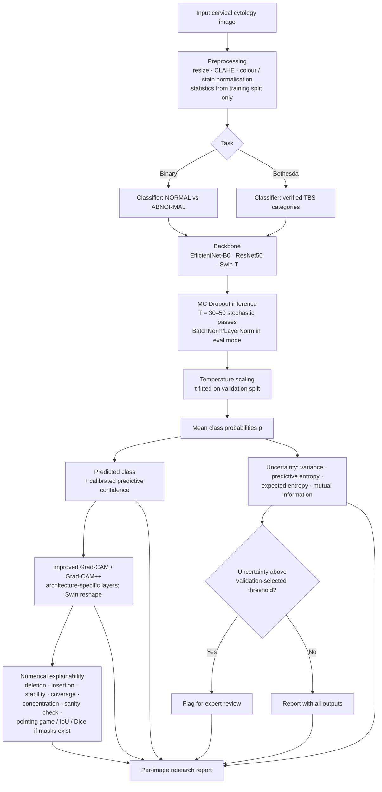

# Research Proposal — Semester Project, 2026–27

**Title:** Uncertainty-Aware and Explainable Deep Learning for Binary and Bethesda-Based Classification of Cervical Cytology Images: Monte Carlo Dropout, Calibrated Predictive Confidence and Quantitative Evaluation of Gradient-Based Explanations

**Submitted to:** Project Guide / Department Review Committee
**Format note:** This proposal follows the content of Part B of the KSCST 50th Series Student Project Programme (SPP 2026–27) proposal format (items 8–21) and expands it into a full academic proposal. Appendix A maps each section to the KSCST item number, so the text can be moved into the KSCST MS Word template. Part A (general information, team, guide, coordinator details), the declaration, the endorsement and the fee details must be filled in directly in the KSCST Word file. They are not reproduced here.

> **Status of this document.** This is a draft for review by the project guide. Items marked **[CONFIRM]** could not be verified from the project repository and must be confirmed by the team before submission. Appendix B lists them all.

---

## Table of Contents

1. Title of the Proposed Research
2. Abstract
3. Introduction
4. Background and Motivation
5. Problem Statement
6. Research Gap
7. Aim and Objectives
8. Proposed Research Contributions
9. Literature Review
10. Proposed Methodology
11. Experimental Design
12. Evaluation Metrics
13. Expected Outcomes
14. Scope and Limitations
15. Proposed Semester Timeline
16. Required Computational Resources
17. Conclusion
18. References

Appendix A — Mapping to the KSCST SPP 2026–27 Proposal Format
Appendix B — Items Requiring Confirmation
Appendix C — Audit of the Existing Implementation
Appendix D — Internal Consistency Check

---

## 1. Title of the Proposed Research

**Uncertainty-Aware and Explainable Deep Learning for Binary and Bethesda-Based Classification of Cervical Cytology Images: Monte Carlo Dropout, Calibrated Predictive Confidence and Quantitative Evaluation of Gradient-Based Explanations**

*Uppercase form for KSCST Part A, item 1:* UNCERTAINTY-AWARE AND EXPLAINABLE DEEP LEARNING FOR BINARY AND BETHESDA-BASED CLASSIFICATION OF CERVICAL CYTOLOGY IMAGES

**Keywords (KSCST item 2, 5–8 keywords):** Cervical cytology; Bethesda System; Deep learning; Monte Carlo Dropout; Uncertainty estimation; Confidence calibration; Grad-CAM; Explainability evaluation.

---

## 2. Abstract

Cervical cancer remains a major cause of cancer death among women worldwide, and cytology-based screening depends on time-consuming expert microscopic review [1], [2]. The project already has a deep-learning pipeline that classifies Pap smear cell images as NORMAL or ABNORMAL using three pretrained architectures: EfficientNet-B0, ResNet50 and Swin Transformer. It also produces Grad-CAM heatmaps. The pipeline reports only the class with the highest score. It does not estimate how reliable a prediction is, does not check whether its softmax scores are calibrated, does not support Bethesda System categories, and does not evaluate its heatmaps quantitatively.

This semester's work extends the existing framework through five connected contributions:

- **(A)** Paired binary (NORMAL vs ABNORMAL) and Bethesda-based multiclass experiments for all three architectures. The Bethesda experiments use a Bethesda-labelled dataset whose categories, counts and annotation structure will be verified before use.
- **(B)** Monte Carlo (MC) Dropout inference [13] to estimate predictive variance, predictive entropy, expected entropy and mutual information. Mutual information is used as an approximate measure of epistemic uncertainty.
- **(C)** Numerical predictive confidence, defined as the maximum mean predictive probability, together with temperature-scaling calibration [18]. Calibration is fitted on validation data and evaluated on held-out test data using Expected Calibration Error, Brier score, negative log-likelihood and reliability diagrams.
- **(D)** An improved explainability module. It covers Grad-CAM [21] and Grad-CAM++ [22], principled target-layer selection for the convolutional networks, and explanation methods suited to the Swin Transformer's architecture.
- **(E)** Quantitative evaluation of explanations. Faithfulness is measured with deletion and insertion scores [25]. Stability is measured under controlled perturbations. Localisation is measured with the pointing game, IoU and Dice, but only where expert region annotations exist.

The integrated framework will output, for each image: a predicted category, class-wise probabilities, calibrated predictive confidence, uncertainty measures, a visual explanation and numerical explanation metrics. Patient- or specimen-level separation of the data splits will be enforced wherever identifiers are available. The work is limited to research and expert-supervised evaluation. It does not claim diagnostic readiness, and it makes no promise of any particular accuracy improvement.

---

## 3. Introduction

Cervical cytology (the Papanicolaou or Pap test, in conventional or liquid-based preparations) is a long-established method for cervical cancer screening. Trained cytotechnologists and cytopathologists examine thousands of cells per slide and report their interpretation using the Bethesda System for Reporting Cervical Cytology (TBS) [3]. Manual screening is labour-intensive, depends on the observer, and is limited by the availability of trained staff, especially in low-resource settings [2].

Deep convolutional neural networks (CNNs) and vision transformers have shown strong performance on public cervical cell datasets such as Herlev [4] and SIPaKMeD [5]; Jiang et al. [8] survey this work. High accuracy on a test split is not enough for use in expert-supervised settings. Three further questions matter:

- **How certain is the model?** A model should show when its prediction is unreliable, for example on ambiguous morphology or unfamiliar staining.
- **Do its scores mean what they appear to mean?** Modern neural networks are often over-confident, so a softmax output of 0.95 is not necessarily right 95% of the time [18].
- **What image evidence drove the prediction, and can that explanation be measured?** Heatmaps such as Grad-CAM are often shown as qualitative illustrations. Visually plausible heatmaps are not necessarily faithful to the model's computation [27].

This proposal sets out a semester plan to answer these questions within the team's existing classification framework. It also extends the framework from binary screening labels to Bethesda-based categories.

---

## 4. Background and Motivation

### 4.1 Clinical background

GLOBOCAN 2022 estimates about 660,000 new cervical cancer cases and about 350,000 deaths worldwide in 2022 [1]. The World Health Organization's elimination strategy makes high-coverage screening and treatment of precancerous lesions one of its three pillars [2]. Cytology remains one of the screening modalities in use.

### 4.2 The Bethesda System

TBS standardises how cervical cytology is reported [3]. For squamous epithelial cells, its main interpretive categories are:

- Negative for Intraepithelial Lesion or Malignancy (**NILM**)
- Atypical Squamous Cells of Undetermined Significance (**ASC-US**)
- Atypical Squamous Cells, cannot exclude HSIL (**ASC-H**)
- Low-grade Squamous Intraepithelial Lesion (**LSIL**)
- High-grade Squamous Intraepithelial Lesion (**HSIL**)
- Squamous Cell Carcinoma (**SCC**)

Glandular categories are also defined. TBS categories are **specimen-level interpretations**: the reporting cytopathologist assigns them to the whole slide after considering all cells and the context. Datasets that attach TBS labels to single cells or image tiles adopt a *derived* labelling convention. This must be stated explicitly (Section 10.2.4).

### 4.3 Existing project and motivation for extension

The existing repository (Appendix C) provides:

- a PyTorch/`timm` pipeline with EfficientNet-B0, ResNet50 and Swin-Tiny backbones with transfer learning;
- loaders for the SIPaKMeD and Herlev datasets;
- a binary NORMAL/ABNORMAL label mapping;
- preprocessing (CLAHE, colour normalisation, optional Macenko stain normalisation) and augmentation;
- a trainer with class weighting, early stopping and standard classification metrics;
- cross-dataset evaluation;
- a Grad-CAM/Grad-CAM++ module built on the `pytorch-grad-cam` library [30], plus a custom Grad-CAM script.

Three gaps motivate this semester's work:

- **Single-point predictions.** Every prediction is a deterministic arg-max with no reliability estimate.
- **No Bethesda categories.** The multiclass mode uses only each dataset's native morphological classes, so TBS categories are not supported.
- **Unevaluated explanations.** Explanations are produced only as images, and the audit found implementation issues in the current explainability code (Appendix C.3).

---

## 5. Problem Statement

The existing cervical cytology classification framework gives a single class label per image. It provides no quantified uncertainty, no evidence that its confidence scores are calibrated, no Bethesda-based multiclass output and no quantitative assessment of its visual explanations. Under these conditions an expert reviewer cannot tell which predictions are trustworthy, which need closer review, or whether the highlighted image regions reflect the evidence the model actually used.

This project therefore asks whether, and to what extent, the following make predictions from EfficientNet-B0, ResNet50 and Swin Transformer classifiers more interpretable and better at flagging unreliable predictions, in both binary and Bethesda-based classification:

1. MC-Dropout-based uncertainty estimation;
2. temperature-scaled confidence calibration;
3. architecture-appropriate gradient-based explanations evaluated with quantitative faithfulness, stability and (where annotations permit) localisation metrics.

The project does not claim to replace expert diagnosis.

---

## 6. Research Gap

The gaps below are stated in relation to the existing project and to commonly reported practice in cervical cytology classification studies. A systematic quantitative survey of the literature is part of Weeks 1–2 and is not claimed here.

| # | Gap | Existing project | Common practice in published cytology classifiers |
|---|-----|------------------|---------------------------------------------------|
| G1 | Paired binary and Bethesda-based evaluation of the same architectures under one protocol | Binary mode and native-class multiclass mode only; no TBS labels | Studies often report a single label scheme, on single-cell datasets with non-TBS classes (e.g. Herlev, SIPaKMeD) [8] |
| G2 | Predictive uncertainty | None (deterministic inference) | Uncertainty is less often reported than accuracy; Leibig et al. [17] show its referral value in another medical-imaging domain |
| G3 | Confidence calibration | Raw softmax only; no ECE, Brier score or NLL | Calibration is rarely reported with classification accuracy |
| G4 | Explanations suited to transformers | Swin explanation path is incomplete (Appendix C.3) | CNN-style Grad-CAM is often applied without architecture-specific handling |
| G5 | Quantitative explanation evaluation | Heatmaps are only visualised | Explanations are often judged by visual inspection, which is insufficient [27] |
| G6 | Leakage-aware, specimen-aware data splitting | Random image-level split, not stratified (Appendix C.2) | Group-level splitting is not consistently reported |

---

## 7. Aim and Objectives

### 7.1 Aim

To extend the existing cervical cytology classification framework into an integrated research framework. For both binary and Bethesda-based classification, the framework will report calibrated predictive confidence, approximate epistemic and total predictive uncertainty, and quantitatively evaluated visual explanations. It will be evaluated with leakage-aware experimental protocols.

### 7.2 Measurable objectives

- **O1. To audit and reproduce** the existing binary classification baselines (EfficientNet-B0, ResNet50, Swin Transformer), correcting the verified defects listed in Appendix C. Measured by a reproducibility report with metrics averaged over at least 3 random seeds.
- **O2. To verify and integrate** the Bethesda-labelled dataset. This means documenting its categories, per-class counts, annotation level (cell, tile or specimen) and patient/specimen identifiers, and defining an approved label map. Measured by a dataset verification report signed off by the project guide.
- **O3. To train and evaluate** the three architectures on (i) binary and (ii) Bethesda-based multiclass tasks under a stratified, group-aware split protocol. Measured by accuracy, precision, recall, macro-F1, per-class F1, confusion matrices, and ROC-AUC/PR-AUC, with 95% bootstrap confidence intervals.
- **O4. To implement** MC Dropout inference with T ∈ {10, 20, 30, 50, 100} passes, and to compute predictive variance, predictive entropy, expected entropy and mutual information. Measured by comparison with deterministic inference, and by the AUROC of each uncertainty measure for detecting misclassifications.
- **O5. To implement and evaluate** numerical predictive confidence and temperature-scaling calibration. Measured by ECE, Brier score, NLL and reliability diagrams on held-out test data, before and after calibration.
- **O6. To improve** the Grad-CAM implementation by adding Grad-CAM++, justified target-layer selection for EfficientNet-B0 and ResNet50, and architecture-appropriate explanation methods for Swin Transformer. Measured by a working, unit-tested module and a documented layer-selection study.
- **O7. To quantify** explanation quality using deletion and insertion AUC, stability under controlled perturbations, activation coverage and concentration, a model-randomisation sanity check and, where annotations exist, pointing-game accuracy, IoU and Dice. Measured by per-method and per-architecture metric tables with statistical comparisons.
- **O8. To integrate and validate** all components in a single inference and evaluation workflow, and to conduct ablation studies and error analysis. Measured by an integrated evaluation report and a draft research paper.

---

## 8. Proposed Research Contributions

The contributions are framed as a systematic, reproducible extension and evaluation of established methods in this application context. They are not claimed as new algorithms.

| ID | Contribution | Status before this semester | Proposed this semester |
|----|--------------|-----------------------------|------------------------|
| **A** | Binary and Bethesda multiclass classification | Binary pipeline exists (with defects to fix); multiclass uses only native SIPaKMeD/Herlev classes | Verified Bethesda label integration; paired binary/Bethesda experiments with group-aware splits |
| **B** | MC Dropout uncertainty estimation | Dropout (p = 0.3) exists in the classification heads; inference is deterministic | Stochastic inference; variance, entropy, expected entropy, mutual information; uncertainty-based error detection and referral analysis |
| **C** | Numerical confidence and calibration | Softmax probabilities are computed but not analysed | Confidence(x) = max_c p̄(c∣x) × 100; temperature scaling; ECE, Brier score, NLL, reliability diagrams |
| **D** | Improved Grad-CAM explainability | Grad-CAM/Grad-CAM++ wrappers and a custom Grad-CAM exist; target-layer selection and the Swin path have defects | Corrected and justified layer selection; Grad-CAM vs Grad-CAM++; Swin-appropriate explanations; class-specific maps; correct overlay and normalisation |
| **E** | Numerical explainability evaluation | None | Deletion/insertion, stability, coverage and concentration, sanity checks; pointing game, IoU and Dice where masks exist |

A further, practical contribution is a **leakage-aware and calibration-aware evaluation protocol** for cervical cytology classifiers that other student and research projects can reuse.

---

## 9. Literature Review

### 9.1 Cervical cytology datasets and deep-learning classification

- **Herlev** [4]: 917 single-cell images in seven classes (three normal, four abnormal grades: mild, moderate and severe dysplasia, and carcinoma in situ). The grading is not TBS.
- **SIPaKMeD** [5]: 4,049 single cells cropped from 966 cluster images in five classes. Superficial-intermediate and parabasal are *normal*; koilocytotic and dyskeratotic are *abnormal*; metaplastic is *benign*.
- **Bethesda-labelled datasets.**
  - The liquid-based cytology dataset of Hussain et al. [6] has 963 *whole-field* images from 460 patients in four TBS-based classes (NILM, LSIL, HSIL, SCC).
  - The CRIC Cervix collection [7] has 400 conventional-smear images with 11,534 classified cells.

  These datasets differ in annotation level (cell vs field), preparation (conventional vs liquid-based) and category coverage. These differences directly affect how any results can be interpreted (Section 10.2).

Deep-learning approaches range from early CNN transfer learning (e.g. DeepPap [9]) to modern CNNs and transformers. A survey by Jiang et al. covers more than 120 publications [8]. This project uses three established backbones: ResNet50 [10], with residual learning; EfficientNet-B0 [11], with compound-scaled mobile inverted bottlenecks; and the Swin Transformer [12], with hierarchical shifted-window self-attention.

### 9.2 Predictive uncertainty

Gal and Ghahramani [13] showed that a network trained with dropout and evaluated with dropout active approximates variational inference in a Bayesian neural network (MC Dropout). Kendall and Gal [14] distinguished *aleatoric* uncertainty (inherent to the data) from *epistemic* uncertainty (from the model and limited data). Following Houlsby et al. [15], total predictive entropy can be split into an expected-entropy term and a mutual-information term; the mutual-information term approximates epistemic uncertainty. Deep ensembles [16] are a strong alternative but cost several times more to train. Leibig et al. [17] showed that MC-Dropout uncertainty can be used to refer uncertain cases for expert review in diabetic retinopathy screening, improving performance on the retained cases. This is the referral paradigm adopted here.

### 9.3 Confidence calibration

Guo et al. [18] showed that modern deep networks are often poorly calibrated. They proposed *temperature scaling*: a single scalar fitted on validation data that rescales logits without changing the arg-max prediction. The Expected Calibration Error (ECE) bins predictions by confidence [19]. The Brier score [20] and negative log-likelihood are proper scoring rules that complement ECE.

### 9.4 Gradient-based visual explanation

- **Grad-CAM** [21] weights the feature maps of a convolutional layer by the spatially averaged gradients of the class score.
- **Grad-CAM++** [22] uses higher-order gradient terms to better handle several instances of a class in one image. This is relevant for multi-cell cytology fields.
- **Transformers.** Attention rollout [23] was designed for transformers with a global class token. Swin Transformer has no class token and uses local windowed attention, so rollout cannot be transferred directly. Gradient-based CAMs on Swin need the token-to-spatial reshaping of the final-stage feature map. Relevance-propagation approaches [24] are a further option.

### 9.5 Evaluating explanations

- **Faithfulness.** Petsiuk et al. [25] introduced *deletion* and *insertion* metrics: the model's class score is tracked as pixels are removed or added in order of saliency.
- **Localisation.** The *pointing game* [26] tests whether the saliency maximum falls inside an annotated object.
- **Sanity checks.** Adebayo et al. [27] showed that some saliency methods produce similar maps for trained and randomised models. Visual plausibility is therefore not evidence of faithfulness.
- **Sensitivity and stability.** Yeh et al. [28] formalised explanation sensitivity (stability) and infidelity.

### 9.6 Summary

The literature provides well-established methods for each component. The proposed contribution is to integrate them in one framework and to evaluate them systematically, under leakage-aware protocols, for cervical cytology across binary and Bethesda-based tasks and across CNN and transformer architectures.

---

## 10. Proposed Methodology

### 10.1 Existing system and baseline models

**Existing components (verified from the repository; see Appendix C):**

- **Backbones** (`models/model_factory.py`, via `timm`): `efficientnet_b0.ra_in1k`, `resnet50.a1_in1k` and `swin_tiny_patch4_window7_224.ms_in1k`, all ImageNet-pretrained. The original classifier head is removed.
- **Classification head:** `Dropout → Linear(d, 512) → ReLU → Dropout → Linear(512, 256) → ReLU → Dropout → Linear(256, K)` with dropout rate p = 0.3. The CNN head also applies global average pooling first.
- **Training** (`training/trainer.py`): AdamW-style optimisation (learning rate 1e-3, weight decay 1e-4), class-weighted cross-entropy, cosine annealing, mixed precision, gradient clipping, early stopping on validation loss, and backbone freezing with scheduled unfreezing.
- **Preprocessing:** resize to 224×224, CLAHE, colour normalisation, optional Macenko stain normalisation [29], and colour and geometric augmentation (Albumentations).
- **Evaluation:** accuracy; macro/weighted precision, recall and F1; per-class metrics; ROC-AUC; confusion matrices; SIPaKMeD↔Herlev cross-dataset evaluation.
- **Explainability** (`xai/grad_cam.py`, `test_gradcam.py`): Grad-CAM and Grad-CAM++ via `pytorch-grad-cam`, a custom Grad-CAM with forward/backward hooks, and an attention-rollout class.

**Baseline reproduction (Weeks 1–2).** The verified defects in Appendix C will be corrected first. The most significant are:

- the default configuration never unfreezes the backbone;
- the dataset loader may include non-image files such as segmentation masks;
- splits are random at image level;
- the Swin feature-dimension handling needs verification.

The three binary baselines will then be retrained from scratch. **No previous numerical results are reported in this proposal.** The repository contains no saved results, and the "expected performance" ranges in `PROJECT_SUMMARY.md` are not measured outcomes. They will not be cited as results.

### 10.2 Dataset description and verification

#### 10.2.1 Datasets

| Dataset | Use in this project | Annotation level | Classes | Size (from original publication) | Status in repository |
|---------|---------------------|------------------|---------|----------------------------------|----------------------|
| SIPaKMeD [5] | Binary training/testing; explanation localisation (nucleus/cytoplasm boundaries) | Single cell (cropped) and cluster image | 5 | 4,049 cells / 966 cluster images | Loader exists; data not committed **[CONFIRM which image set is loaded]** |
| Herlev [4] | Binary external test; explanation localisation (segmentation images) | Single cell | 7 | 917 cells | Loader exists; README reports 1,834 files, which is exactly 2 × 917 **[CONFIRM]** |
| Bethesda-labelled dataset (team-held) | Bethesda multiclass experiments | **[CONFIRM]** | **[CONFIRM]** | **[CONFIRM]** | Not present in repository |

The team reports that it already holds a Bethesda-labelled dataset. Its identity, source, licence, category list, per-class counts, image type and identifiers were **not available** in the repository and are **not stated** here. Two published candidates are the Hussain et al. LBC dataset [6] (NILM/LSIL/HSIL/SCC, whole-field images) and CRIC Cervix [7]. Neither is assumed to be the team's dataset.

#### 10.2.2 Verification protocol (Week 3, before any Bethesda experiment)

1. **Provenance:** source, citation, licence and terms of use; whether ethics approval or de-identification is documented.
2. **Inventory:** total image count; per-category counts; file formats; resolution and magnification; duplicates (detected by perceptual hashing); corrupt or non-image files (e.g. masks).
3. **Annotation structure:** is each label assigned per cell, per tile/field or per specimen? Are cell bounding boxes or segmentation masks provided? How many annotators labelled each item, and is inter-observer agreement reported?
4. **Category set:** record exactly which TBS categories are present. **Only those categories will be modelled.** Categories with too few images for a stable estimate will be reported but may be merged *only* if the merge is clinically defensible and approved by the guide (e.g. ASC-H handled with HSIL as a "high-grade" group), or excluded with justification. Absent categories (e.g. ASC-US or ASC-H if not present) will not be introduced.
5. **Identifiers:** patient, specimen or slide IDs, and the parent field image for cropped cells, used for group-aware splitting.
6. **Preparation type:** conventional or liquid-based. This matters for domain shift with SIPaKMeD and Herlev, which come from conventional smears.

Output: a *dataset verification report* (Deliverable D3).

#### 10.2.3 Label mapping policy

- **Binary task.** The existing mapping is retained for comparison but will be **re-examined**. The current code maps SIPaKMeD *Metaplastic* to ABNORMAL, whereas the SIPaKMeD authors classify metaplastic cells as *benign* [5]. Three variants will be compared and reported:
  - metaplastic → NORMAL (as in the dataset publication);
  - metaplastic → ABNORMAL (current code);
  - metaplastic excluded.

  The primary analysis will follow the dataset publication unless the guide decides otherwise.
- **Bethesda task.** Labels come **only** from the dataset's own TBS annotations.
- **No automatic mapping.** Generic ABNORMAL labels will **not** be converted into Bethesda categories, and Herlev dysplasia grades or SIPaKMeD morphological classes will **not** be used as TBS ground truth. Any exploratory cross-scheme analysis (e.g. Herlev mild dysplasia in relation to LSIL) will be labelled as exploratory, documented, and reviewed by a qualified cytopathologist before it is reported.
- **Binary view of Bethesda data.** For a binary evaluation of the Bethesda dataset, NILM → NORMAL and all present squamous abnormality categories → ABNORMAL. This mapping comes directly from TBS, unlike the reverse direction.

#### 10.2.4 Single-cell vs specimen-level interpretation

TBS categories are interpretations of whole specimens [3]. A model trained on single cells or on fields predicts the label of *that image*. It does not interpret the slide. All results will be described as cell- or image-level classification, and no claim will be made about specimen-level Bethesda reporting. Aggregating image-level predictions into a specimen-level estimate is outside the scope of this project (Section 14).

#### 10.2.5 Preprocessing

The existing preprocessing is kept, with these controls:

- Normalisation statistics and stain-normalisation reference images are taken from the **training split only**.
- Augmentation is applied only during training.
- The effect of CLAHE and stain normalisation is evaluated in the ablation study (E11) and is not assumed to help.
- Resolution: 224×224 for all backbones. Aspect-ratio-preserving padding will be compared with direct resizing for cell images.

#### 10.2.6 Data splitting and leakage prevention

The existing `random_split` will be replaced with **stratified group splitting**:

- Groups are patient/specimen/slide IDs where available. For SIPaKMeD crops, the parent cluster image is used as the group.
- Primary protocol: a fixed 70/15/15 train/validation/test split with stratification by class, repeated over 3 seeds. Where the data are small (Herlev, minority Bethesda classes), stratified group 5-fold cross-validation is also run.
- The **test split is used once**, for final reporting. Early stopping, model selection, temperature fitting and uncertainty-threshold selection use the **validation split only**.
- Where no identifiers exist (e.g. Herlev), this is stated as a limitation, and near-duplicate detection is used as a partial safeguard.

#### 10.2.7 Class imbalance

Imbalance is expected, particularly in Bethesda categories. The following will be compared:

- class-weighted cross-entropy (existing);
- class-balanced sampling;
- focal loss, as an optional ablation.

Macro-F1 and per-class recall are the primary metrics because accuracy is misleading under imbalance. Note that resampling and reweighting can affect calibration, so calibration is always assessed after the training choice is fixed.

### 10.3 Binary classification

- **Task:** K = 2 (NORMAL, ABNORMAL).
- **Settings:**
  - (i) within-dataset (SIPaKMeD → SIPaKMeD test; Bethesda dataset binarised → its own test);
  - (ii) cross-dataset (SIPaKMeD → Herlev, using the existing cross-dataset module), reported separately as a domain-shift analysis.
- **Training:** two-phase transfer learning. The head is trained with the backbone frozen for *e*₁ epochs, then the full network is fine-tuned at a lower learning rate. *e*₁ and the total epochs are chosen so that unfreezing actually happens (Appendix C.1).
- **Operating point:** besides arg-max decisions, a validation-selected threshold targeting high ABNORMAL recall will be reported, because missed abnormalities are the costlier error in screening.

### 10.4 Bethesda multiclass classification

- **Task:** K = number of verified TBS categories present in the dataset (Section 10.2.2).
- **Same three architectures and training protocol**, with the head output size set to K.
- **Reporting:** full K×K confusion matrices; per-class precision, recall and F1; macro-F1; one-vs-rest ROC-AUC and PR-AUC.
- **Ordinal error analysis:** errors between adjacent grades (e.g. LSIL↔HSIL) are clinically different from errors between distant ones (e.g. NILM↔SCC). Error severity is reported descriptively using the confusion matrix. No ordinal loss is introduced unless time permits (optional ablation).

### 10.5 Monte Carlo Dropout uncertainty estimation

**Inference procedure.** The model is put in evaluation mode, so BatchNorm and LayerNorm use their stored statistics. *Only* the `nn.Dropout` modules are then switched to training mode. For each input *x*, *T* stochastic forward passes are run with independent dropout masks ŵₜ, giving softmax vectors

$$\mathbf{p}_t = \mathrm{softmax}\big(\mathbf{z}_t / \tau\big), \qquad t = 1,\dots,T,$$

where **z**ₜ are the logits and τ is the temperature (τ = 1 before calibration; Section 10.6).

**Quantities computed:**

- Mean predictive probability:
  $$\bar{p}(c\mid x) = \frac{1}{T}\sum_{t=1}^{T} p_t(c\mid x)$$
- Predicted class:
  $$\hat{y} = \arg\max_c \bar{p}(c\mid x)$$
- Predictive variance (class-wise, and summarised for the predicted class or averaged over classes):
  $$\sigma^2(c\mid x) = \frac{1}{T}\sum_{t=1}^{T}\big(p_t(c\mid x) - \bar{p}(c\mid x)\big)^2$$
- Predictive entropy (total uncertainty):
  $$\mathcal{H}[\bar{\mathbf{p}}] = -\sum_{c=1}^{K} \bar{p}(c\mid x)\log \bar{p}(c\mid x)$$
- Expected entropy (approximate aleatoric component):
  $$\mathbb{E}_t\,\mathcal{H}[\mathbf{p}_t] = -\frac{1}{T}\sum_{t=1}^{T}\sum_{c=1}^{K} p_t(c\mid x)\log p_t(c\mid x)$$
- Mutual information (approximate epistemic component) [15]:
  $$\mathcal{I}(y; \mathbf{w}\mid x) \approx \mathcal{H}[\bar{\mathbf{p}}] - \mathbb{E}_t\,\mathcal{H}[\mathbf{p}_t]$$

For comparison across tasks, entropies are also reported normalised by log K.

**Interpretation and caveats.**

- MC Dropout gives an *approximation* to Bayesian model uncertainty [13]. The approximation depends on dropout placement and rate.
- In the existing models, dropout exists **only in the classification head**. The estimated epistemic uncertainty therefore reflects only uncertainty over the head's parameters, given fixed backbone features.
- An ablation (E8) will compare head-only MC Dropout with additional stochasticity in the backbone. For Swin, this is stochastic depth (drop-path), which `timm` supports. For CNNs, it is a dropout layer inserted before the final stage.
- Results will be presented as estimates under these modelling choices, not as true posterior uncertainty.

**Computational note.** When dropout is head-only, the backbone is deterministic. Its features can be computed once per image and the head evaluated *T* times. This gives exactly the same MC estimate at a fraction of the cost, which makes T = 50–100 practical.

**Number of passes.** The primary setting is T = 30 and T = 50. Convergence will be checked with T ∈ {10, 20, 30, 50, 100}, by plotting the stability of p̄, of the mutual information, and of error-detection AUROC against T.

**Deterministic vs stochastic inference.** For each model and task, deterministic predictions (dropout off) are compared with MC predictions (arg-max of p̄) on classification metrics, calibration metrics and error-detection ability.

**Correct vs incorrect predictions.** The distributions of each uncertainty measure for correctly and incorrectly classified test samples are compared (Mann–Whitney U test, with effect size). Separability is summarised as the AUROC of the uncertainty score as a detector of misclassification.

**Expert-review referral (selective prediction).** Samples are ranked by an uncertainty score (predictive entropy, mutual information, or 1 − calibrated confidence). For a referral fraction *r* ∈ [0, 0.5], the most-uncertain *r* fraction is "referred" and metrics are computed on the retained samples. The output is an accuracy- or macro-F1-vs-referral curve and the area under the risk–coverage curve (AURC). A referral threshold is chosen on validation data and applied unchanged to test data. This simulates the use of uncertainty to prioritise samples for expert review. It is not a clinical triage policy.

### 10.6 Numerical confidence estimation and calibration

**Definition.** The numerical predictive confidence is

$$\mathrm{Confidence}(x) = \max_{c}\ \bar{p}(c\mid x)\times 100\ (\%).$$

Under deterministic inference, p̄ is the single softmax output. The framework reports the predicted class, all class-wise probabilities p̄(c∣x), the raw confidence, the **calibrated predictive confidence** (below) and the uncertainty measures of Section 10.5.

**Why raw confidence is insufficient.** A softmax probability is a model score. It is a reliable estimate of the chance of being correct only if the model is calibrated, meaning that among predictions with confidence ≈ q, a fraction ≈ q are correct. Modern deep networks are often over-confident [18]. Class weighting, resampling and domain shift can all distort calibration further.

**Temperature scaling [18].** A single scalar τ > 0 is fitted by minimising the NLL on the **validation split**:

$$\tau^{\star} = \arg\min_{\tau>0}\ -\sum_{(x,y)\in\mathcal{D}_{\text{val}}}\log \mathrm{softmax}\big(\mathbf{z}(x)/\tau\big)_y.$$

- For MC inference, τ is applied to each pass's logits before averaging, and is fitted on the MC-averaged validation NLL.
- Temperature scaling does not change the arg-max of a deterministic model. Under MC averaging it can change predictions slightly, and any such change will be reported.
- Optional extension (time permitting): vector scaling for the multiclass task.

**Calibration metrics** (computed on the **test split**; Section 12.2): ECE with M = 15 equal-width bins (plus an equal-mass variant), class-wise ECE for the Bethesda task, Brier score, NLL, and reliability diagrams with per-bin counts.

**Terminology and interpretation.**

- The output is called **calibrated predictive confidence**: the model's calibrated estimate of the probability that *its predicted label for this image* is correct, *under the conditions of the evaluation data*.
- It is **not** the probability that a patient has cancer. It is not a risk score, and it is not guaranteed to stay calibrated under distribution shift. The cross-dataset (SIPaKMeD → Herlev) setting will be used to measure how calibration changes under shift.
- Confidence and uncertainty are complementary, not interchangeable. A prediction may have moderate confidence because the image is genuinely ambiguous (high expected entropy, low mutual information). It may also arise from model disagreement across dropout masks (high mutual information). Both are reported.

### 10.7 Improved Grad-CAM explainability

**Corrections to the existing implementation** (Appendix C.3):

- Gradient computation must not run under `torch.no_grad()`.
- Target-layer selection must pick one specified layer, not every matching sub-module.
- Overlays must be made on correctly de-normalised images (inverting the ImageNet mean/std).
- The deprecated full backward hook must be replaced.
- The Swin reshape must not drop a non-existent class token.

**Grad-CAM [21].** For target class *c* and feature map Aᵏ of the chosen layer:

$$\alpha_k^c = \frac{1}{Z}\sum_{i,j}\frac{\partial y^c}{\partial A^k_{ij}}, \qquad L^c_{\text{Grad-CAM}} = \mathrm{ReLU}\Big(\sum_k \alpha_k^c A^k\Big).$$

**Grad-CAM++ [22].** Pixel-wise weights are built from higher-order gradient terms:

$$\alpha_{ij}^{kc} = \frac{\partial^2 y^c/(\partial A^k_{ij})^2}{2\,\partial^2 y^c/(\partial A^k_{ij})^2 + \sum_{a,b} A^k_{ab}\,\partial^3 y^c/(\partial A^k_{ij})^3},$$

with $w_k^c = \sum_{i,j}\alpha^{kc}_{ij}\,\mathrm{ReLU}(\partial y^c/\partial A^k_{ij})$. In practice the exponential-of-score formulation of [22] is used, as implemented in [30].

**Target-layer selection.**

- **ResNet50:** the output of the last bottleneck block of `layer4` (7×7×2048 at 224² input) is the default. `layer3` (14×14) will be compared for spatial resolution.
- **EfficientNet-B0:** the final convolutional stage (`conv_head` / last block of `blocks`, 7×7) is compared with the preceding stage (14×14).
- **Selection criterion:** among candidate layers, the one with the best validation deletion/insertion faithfulness (Section 10.8) is selected, with resolution as a secondary consideration. The choice is fixed before test evaluation.

**Swin Transformer (architecture-specific handling).**

Swin produces hierarchical feature maps (in `timm`, the final stage is 7×7×768 in channels-last layout). It has **no class token** and uses windowed self-attention. Therefore:

- **Gradient-based CAM on Swin.** Grad-CAM and Grad-CAM++ are applied to the output of the final stage's last block, or to its final norm layer, with an explicit `reshape_transform` that converts tokens into a (B, C, H, W) tensor without removing any token. The penultimate stage (14×14) is compared as well.
- **Attention rollout as originally formulated** [23] assumes global attention and a class token. It is therefore *not* applied directly. The existing `AttentionRollout` class depends on an `.attention` attribute that `timm` Swin modules do not expose, so it captures nothing at present.
- **Optional, time permitting:** a gradient-weighted, Swin-adapted relevance method in the spirit of [24], or a model-agnostic perturbation method (RISE [25]) as a non-gradient reference explanation for all three architectures.

**Class-specific heatmaps.** Maps are generated for (i) the predicted class, (ii) the true class when it differs, and (iii) for Bethesda, the second-most-probable class. This allows contrastive inspection, e.g. LSIL vs HSIL evidence.

**Normalisation and overlay.**

- Maps are upsampled bilinearly to input resolution, then min–max normalised per image for display.
- For quantitative metrics, *unnormalised* maps are retained so that magnitudes can be compared.
- A perceptually uniform colour map (e.g. viridis) and a fixed overlay opacity are used.
- Overlays are drawn on the de-normalised original image (before CLAHE, with the processed view shown alongside).

**Comparisons.** Grad-CAM vs Grad-CAM++; correct vs incorrect predictions; low- vs high-uncertainty predictions; binary vs Bethesda models on the same images, where datasets overlap or a common test set exists.

**Interpretive caution.** A heatmap shows which input regions affected the chosen class score through the selected layer. It does **not** show that the model uses clinically valid morphological criteria. Statements about clinical relevance are restricted to the localisation analyses against expert annotations in Section 10.8.

### 10.8 Numerical explainability evaluation

Three properties are distinguished and evaluated separately:

- **Faithfulness:** does the explanation reflect what the model actually relies on?
- **Stability:** is it robust to perturbations that should not change it?
- **Localisation:** does it coincide with expert-annotated regions?

None of these, alone or together, establishes clinical validity.

Notation: *S* ∈ ℝ^{H×W} is the saliency map upsampled to input size; *Ŝ* is its min–max-normalised version; *f_c(x)* is the (calibrated) probability of the explained class.

| Metric | Property | Definition and computation | Data required |
|--------|----------|----------------------------|---------------|
| **Deletion AUC** [25] | Faithfulness | Pixels (in 2–5% steps, as 8×8 or 16×16 patches) are removed in descending saliency order by replacing them with a blurred or mean baseline. *f_c* is recorded after each step. The score is the area under the curve; **lower is better**. The baseline choice is reported, and a random-order deletion curve serves as reference | Images + model |
| **Insertion AUC** [25] | Faithfulness | Starting from the blurred baseline, pixels are restored in descending saliency order. Area under the *f_c* curve; **higher is better** | Images + model |
| **Model-randomisation sanity check** [27] | Faithfulness (necessary condition) | The model's layers are randomised in cascading order and explanations recomputed. Spearman rank correlation and SSIM with the original maps are reported. High similarity indicates that the method is insensitive to the model | Images + model |
| **Stability / sensitivity** [28] | Stability | Controlled perturbations: small Gaussian noise (σ chosen so that the prediction is unchanged), mild stain/colour jitter within the training-augmentation range, and flips/90° rotations with the map transformed back. Spearman rank correlation, SSIM and top-k% overlap between original and perturbed maps, plus max-sensitivity ‖S(x) − S(x′)‖ / ‖S(x)‖. Only perturbations that keep the predicted class are counted | Images + model |
| **Activation coverage** | Descriptive (spread) | Coverage_τ = (1/HW)·Σᵢⱼ 𝟙[Ŝᵢⱼ ≥ τ] for τ ∈ {0.3, 0.5, 0.7}: the fraction of the image highlighted | Map only |
| **Explanation concentration** | Descriptive (focus) | (i) Top-10% mass: share of total saliency in the top 10% of pixels; (ii) normalised spatial entropy of S/ΣS. Higher concentration means a more focused map; this is *not* the same as being more correct | Map only |
| **Pointing game** [26] | Localisation | A hit if argmax(S) lies inside the annotated region, with a tolerance of 15 px. Accuracy = hits / (hits + misses) | Expert region annotation per image |
| **IoU and Dice** | Localisation | Binarise Ŝ at threshold τ (fixed on validation data, or Otsu's method). IoU = ∣M∩G∣/∣M∪G∣; Dice = 2∣M∩G∣/(∣M∣+∣G∣), where G is the expert mask | Pixel-level expert masks |

**Annotation availability and its implications.**

- SIPaKMeD provides nucleus and cytoplasm boundary annotations [5]. Herlev distributes segmentation images with its cell images **[CONFIRM in the local copy]**. These annotations delineate **cell structures**. They do not delineate diagnostic evidence.
- Localisation against nucleus masks is a meaningful *proxy*, because many TBS criteria concern nuclear features (enlargement, hyperchromasia, irregular contours) [3]. It is reported as "agreement with expert-delineated nuclear regions", not as "clinically correct explanation".
- For the Bethesda dataset, localisation metrics are computed **only if** cell- or lesion-level masks or boxes exist **[CONFIRM]**. If they do not, only faithfulness, stability and descriptive metrics are reported for that task.
- If expert time is available, a small expert-annotated subset (e.g. 50–100 images marked by a cytopathologist) would allow genuine lesion-level localisation. This is listed as optional.

**Statistical comparison.** Per-image metric values are compared across methods (Grad-CAM vs Grad-CAM++) and layers with the Wilcoxon signed-rank test (paired). Comparisons across architectures use bootstrap 95% confidence intervals. Multiple comparisons are corrected with the Holm procedure.

### 10.9 Integrated framework

**Per-image output record** (research use): image ID; task; predicted class; class-wise probabilities; raw confidence; calibrated predictive confidence; predictive variance; predictive entropy; expected entropy; mutual information; referral flag; Grad-CAM and Grad-CAM++ maps; deletion/insertion AUC; stability score; coverage and concentration; localisation scores where available. These records are aggregated into the evaluation tables in Sections 11–12.

---

## 11. Experimental Design

### 11.1 General protocol

- **Seeds and splits:** 3 random seeds per configuration, with group-aware stratified splits fixed per seed and shared across architectures. Results are reported as mean ± standard deviation, with 95% bootstrap confidence intervals (1,000 resamples) on the test split.
- **Hyperparameters:** chosen on the validation split only, using a limited grid over learning rate {1e-4, 3e-4, 1e-3} and dropout p {0.2, 0.3, 0.5}. All other settings are inherited from the existing configuration.
- **Paired statistical tests:** McNemar's test for paired classifier predictions; DeLong's test or bootstrap for AUC differences; Wilcoxon signed-rank for per-image uncertainty and explanation metrics; Holm correction for multiple comparisons.
- **Reproducibility:** configuration files, seeds, split index files, software versions and checkpoints are versioned in the repository. Model weights and data are excluded if licences require it.

### 11.2 Experimental comparison matrix

| ID | Experiment | Architectures | Task(s) | Compared conditions | Primary outputs |
|----|-----------|---------------|---------|---------------------|-----------------|
| E1 | EfficientNet-B0 baseline | EfficientNet-B0 | Binary, Bethesda | Deterministic, uncalibrated | Classification metrics |
| E2 | ResNet50 baseline | ResNet50 | Binary, Bethesda | Deterministic, uncalibrated | Classification metrics |
| E3 | Swin Transformer baseline | Swin-T | Binary, Bethesda | Deterministic, uncalibrated | Classification metrics |
| E4 | Binary classification study | All three | Binary (within-dataset; cross-dataset SIPaKMeD → Herlev; binarised Bethesda) | Architectures; metaplastic mapping variants | Accuracy, P/R, macro-F1, ROC-AUC, PR-AUC, confusion matrices |
| E5 | Bethesda multiclass study | All three | Bethesda (verified K) | Architectures; imbalance strategies | Per-class F1, macro-F1, K×K confusion matrix, OvR ROC/PR-AUC |
| E6 | Deterministic vs MC Dropout | All three | Both | Dropout off vs MC (T = 30, 50); T-sweep {10,20,30,50,100} | Classification metrics; uncertainty distributions; convergence vs T; error-detection AUROC |
| E7 | Raw vs calibrated confidence | All three | Both | Uncalibrated vs temperature-scaled (deterministic and MC) | ECE, class-wise ECE, Brier score, NLL, reliability diagrams; in-domain vs cross-dataset |
| E8 | Grad-CAM vs Grad-CAM++ | All three | Both | Method × target layer (two candidates per architecture) | Deletion/insertion AUC, sanity check, qualitative panels |
| E9 | Numerical explainability comparison | All three | Both | Methods; correct vs incorrect; low vs high uncertainty; binary vs Bethesda | Stability, coverage, concentration, pointing game / IoU / Dice where masks exist |
| E10 | Integrated framework evaluation | Best configuration per architecture | Both | Full pipeline vs baseline | All outputs jointly; referral curves (macro-F1 vs referral rate); AURC; per-image reports |
| E11 | Ablation studies | Selected | Both | See Section 11.3 | Change in classification, calibration, uncertainty and explanation metrics |
| E12 | Error analysis | Selected | Both | Misclassified and high-uncertainty samples | Categorised error cases; confusion pairs; associated explanations |

### 11.3 Ablation studies (E11)

1. **Dropout placement:** head-only MC Dropout vs head + backbone stochasticity (drop-path for Swin; inserted dropout for CNNs).
2. **Dropout rate:** p ∈ {0.2, 0.3, 0.5}, examining the effect on accuracy, calibration and mutual information.
3. **Number of MC passes:** T sweep (shared with E6).
4. **Calibration order:** temperature scaling applied before vs after MC averaging; deterministic + TS vs MC + TS.
5. **Preprocessing:** with vs without CLAHE; with vs without Macenko stain normalisation.
6. **Imbalance handling:** class-weighted loss vs balanced sampling (vs focal loss, optional).
7. **Binary label definition:** metaplastic → NORMAL / ABNORMAL / excluded.
8. **Explanation layer:** final vs penultimate stage for each architecture.
9. **Deletion baseline:** blur vs mean-colour replacement, to show how sensitive faithfulness scores are to the baseline.

### 11.4 Error analysis (E12)

- Misclassified test samples are grouped by confusion pair (e.g. LSIL→NILM, HSIL→LSIL) and by uncertainty quadrant (correct vs incorrect × low vs high mutual information).
- For a stratified sample of these groups, the team will record image quality (focus, overlap, staining), the heatmap pattern (focused on the nucleus, diffuse, background) and, if expert review is available, the expert's interpretation.
- High-confidence errors (calibrated confidence ≥ 90% but wrong) will receive particular attention, because these are the cases uncertainty-based referral is least likely to catch.

---

## 12. Evaluation Metrics

### 12.1 Classification

| Metric | Definition / note |
|--------|-------------------|
| Accuracy | (correct predictions) / N; reported but not primary, because of imbalance |
| Precision, Recall | Per class and macro-averaged; ABNORMAL recall (sensitivity) and NORMAL recall (specificity) reported for binary |
| Macro-F1 | Unweighted mean of per-class F1; **primary metric** |
| Per-class F1 | Reported for every class, especially minority Bethesda categories |
| Confusion matrix | Raw counts and row-normalised |
| ROC-AUC | Binary; one-vs-rest macro for multiclass |
| PR-AUC | Binary (ABNORMAL as positive) and one-vs-rest per class; more informative than ROC-AUC under imbalance |

### 12.2 Uncertainty and calibration

| Metric | Definition |
|--------|-----------|
| Predictive variance | σ²(c∣x) over T passes (Section 10.5) |
| Predictive entropy | 𝓗[p̄] (total uncertainty) |
| Expected entropy | 𝔼ₜ𝓗[pₜ] |
| Mutual information | 𝓗[p̄] − 𝔼ₜ𝓗[pₜ] (approximate epistemic uncertainty) |
| ECE | $\mathrm{ECE}=\sum_{m=1}^{M}\frac{\lvert B_m\rvert}{N}\,\big\lvert \mathrm{acc}(B_m)-\mathrm{conf}(B_m)\big\rvert$, M = 15 equal-width bins; equal-mass variant also reported |
| Class-wise ECE | ECE computed per class on one-vs-rest probabilities, averaged (multiclass) |
| Brier score | $\frac{1}{N}\sum_{i}\sum_{c}\big(\bar p(c\mid x_i)-\mathbb{1}[y_i=c]\big)^2$ |
| Negative log-likelihood | $-\frac{1}{N}\sum_i \log \bar p(y_i\mid x_i)$ |
| Reliability diagram | Per-bin accuracy vs confidence, with bin counts |
| Uncertainty-based error detection | AUROC and AUPR of each uncertainty score (and of 1 − confidence) for predicting misclassification |
| Selective prediction | Macro-F1 / accuracy vs referral rate curves; AURC; performance at a validation-selected referral threshold |

### 12.3 Explainability

Deletion AUC (↓), insertion AUC (↑), model-randomisation similarity (↓ is desirable), stability (Spearman/SSIM ↑, max-sensitivity ↓), activation coverage (descriptive), concentration (descriptive), pointing-game accuracy (↑), IoU and Dice (↑). The last three are reported only where expert masks exist. Definitions are in Section 10.8.

---

## 13. Expected Outcomes

These are the outputs the project is designed to produce. They are not predicted numbers. No specific accuracy, calibration or explanation scores are promised.

**Technical outcomes**

1. A corrected, reproducible baseline for EfficientNet-B0, ResNet50 and Swin-T in binary classification, with group-aware splits.
2. A verified Bethesda dataset integration (report and data loader) and multiclass baselines for all three architectures, restricted to the categories actually present.
3. An MC Dropout inference module that outputs class probabilities, predictive variance, predictive entropy, expected entropy and mutual information, with an empirical study of the effect of T.
4. A calibration module (temperature scaling) with ECE, Brier score, NLL and reliability-diagram evaluation. It will establish whether and by how much the existing models are miscalibrated, and whether temperature scaling reduces miscalibration in-domain and under cross-dataset shift.
5. A corrected and extended explainability module: Grad-CAM and Grad-CAM++ with justified layer choices for CNNs, and architecture-appropriate handling for Swin.
6. A quantitative explanation-evaluation toolkit (faithfulness, stability, descriptive, and localisation metrics where annotations exist).
7. An integrated evaluation workflow producing a per-image research report.
8. Ablation and error-analysis results that show which design choices matter.

**Academic outcomes**

- A final project report and a draft research paper describing the protocol and findings, including negative or null results (e.g. if calibration or MC Dropout gives no measurable benefit for a given architecture).
- Reusable, documented code in the existing repository.

**Societal relevance (stated cautiously)**

The work targets *research* questions relevant to future expert-supervised decision-support tools for cervical screening, a women's-health priority [2]. Any translation towards clinical use would require prospective, multi-centre validation, regulatory review and clinical governance, all of which are outside the scope of this project.

---

## 14. Scope and Limitations

**In scope:** image-level classification of cervical cytology images (binary and verified Bethesda categories); MC Dropout uncertainty; temperature-scaling calibration; Grad-CAM/Grad-CAM++ and Swin-appropriate gradient explanations; quantitative explanation evaluation; experiments on publicly available datasets and on the team-held Bethesda dataset (subject to verification).

**Out of scope:** whole-slide image analysis; cell detection and segmentation pipelines; specimen-level Bethesda reporting; glandular-cell categories, unless present and adequately sized; HPV co-testing; prospective or clinical evaluation; deployment.

**Limitations**

1. **Single-cell vs specimen level.** Predictions are image-level. They are not equivalent to a specimen-level TBS interpretation (Section 10.2.4).
2. **Dataset size and coverage.** Public datasets are small and from a few centres. Some TBS categories (notably ASC-US and ASC-H) may be absent or rare, which limits multiclass conclusions.
3. **Missing identifiers.** Where patient or specimen IDs are unavailable (e.g. Herlev), complete leakage control cannot be guaranteed.
4. **MC Dropout is an approximation.** Its uncertainty depends on dropout placement and rate. With head-only dropout it does not capture backbone uncertainty. Mutual information is an approximate, not exact, measure of epistemic uncertainty.
5. **Calibration under shift.** Temperature scaling is fitted in-domain and may not stay calibrated on data from other laboratories, stains or scanners.
6. **Explanation validity.** Grad-CAM-family maps are coarse (7×7 or 14×14 before upsampling). Deletion/insertion scores depend on the baseline. Agreement with nucleus masks is a proxy, not proof of clinically valid reasoning.
7. **Label noise and inter-observer variability** in cytology ground truth limit achievable performance and calibration assessment.
8. **Compute constraints** may limit the T-sweep, the number of seeds or the ablation breadth. Priorities are set in Section 15.

### 14.1 Ethical, privacy and data-governance considerations

- **Data use:** only datasets with documented provenance and licences permitting research use will be used. Licence terms and citations will be recorded in the dataset verification report.
- **De-identification:** images must contain no patient identifiers (including slide labels in the field of view). Any identifiers used for group splitting are kept as opaque codes and not published.
- **Ethics approval:** if the team-held Bethesda dataset was collected locally rather than obtained from a public repository, institutional ethics committee approval and data-sharing agreements must be confirmed before use **[CONFIRM]**.
- **Storage:** data are stored on institution-controlled or access-controlled storage and are not committed to public repositories. Model checkpoints are shared only where data licences allow.
- **Intended use:** the framework is for research and expert-supervised evaluation only. It is **not** a medical device and must not be used for standalone diagnosis or patient management. All outputs and reports will carry this statement.
- **Responsible reporting:** limitations, negative results and failure cases will be reported. Confidence outputs will be described as calibrated predictive confidence, not as patient-level cancer probability.
- **Academic integrity:** the KSCST declaration restricts the use of AI tools for generating core technical content. All text, code and results must be reviewed, verified and owned by the student team and the project guide (see Appendix B).

---

## 15. Proposed Semester Timeline

### 15.1 Sixteen-week plan

| Weeks | Phase | Activities | Milestone | Tangible deliverables |
|-------|-------|-----------|-----------|----------------------|
| 1–2 | Existing pipeline audit and baseline reproduction | Literature survey consolidation; fix verified defects (Appendix C); implement stratified group splits; verify SIPaKMeD/Herlev file inventories; retrain binary baselines (3 architectures × 3 seeds) | **M1:** Reproducible binary baselines | D1: Audit and fix log; D2: Baseline results table (binary, with CIs); split index files |
| 3–4 | Bethesda dataset integration and multiclass baselines | Execute the dataset verification protocol; define and approve the label map; implement the loader; train multiclass baselines; evaluate imbalance strategies | **M2:** Verified Bethesda dataset and multiclass baselines | D3: Dataset verification report (signed off by guide); D4: Multiclass baseline results |
| 5–6 | MC Dropout and uncertainty evaluation | Implement dropout-only stochastic inference with feature caching; compute all uncertainty measures; T-sweep; deterministic vs MC comparison; correct vs incorrect analysis; implement temperature scaling and calibration metrics | **M3:** Uncertainty and calibration modules validated | D5: MC Dropout and calibration code with unit tests; D6: Uncertainty and calibration report (E6, E7) |
| 7–8 | Improved Grad-CAM and Grad-CAM++ | Correct the explainability module; layer-selection study; Swin reshape handling; class-specific maps; overlay and normalisation fixes; qualitative panels | **M4:** Corrected explainability module for all architectures | D7: Explainability module and layer-selection report |
| 9–10 | Numerical explainability | Implement deletion/insertion, stability, coverage, concentration, sanity check; pointing game, IoU and Dice on SIPaKMeD/Herlev masks (and Bethesda masks if available) | **M5:** Explanation-evaluation toolkit validated | D8: Explainability metrics code; D9: Explanation evaluation report (E8, E9) |
| 11–12 | Integrated binary and Bethesda experiments | End-to-end integrated pipeline; per-image reports; referral and selective-prediction analysis; cross-dataset calibration analysis | **M6:** Integrated framework results | D10: Integrated evaluation report (E10); per-image report generator |
| 13–14 | Ablation studies and error analysis | Run the ablations in Section 11.3 (in priority order); error categorisation; statistical testing | **M7:** Ablation and error analysis complete | D11: Ablation tables; D12: Error-analysis report with case panels |
| 15–16 | Final evaluation, documentation and paper preparation | Final test-set evaluation (once); consolidate results; code documentation; final report; draft research paper; presentation | **M8:** Final submission | D13: Final project report; D14: Draft research paper; D15: Documented code release; D16: Presentation and poster |

**Priority if compute or time is short** (highest first): E4 and E5 baselines → E6 → E7 → E8 → E9 (faithfulness before localisation) → E10 → ablations 1, 4 and 7 → remaining ablations.

**Mid-semester review:** at the end of Week 8, the project will be reviewed against milestones M1–M4 with the project guide.

### 15.2 Mapping to the KSCST five-month work plan (KSCST item 17)

The KSCST format asks for a monthly plan over Months 1–5. Weeks 1–16 correspond to approximately Months 1–4. Month 5 is reserved for buffer, final validation and report finalisation.

| Activity | Month 1 (Wk 1–4) | Month 2 (Wk 5–8) | Month 3 (Wk 9–12) | Month 4 (Wk 13–16) | Month 5 |
|----------|:---:|:---:|:---:|:---:|:---:|
| Literature survey | ✓ | ✓ | | | |
| Design | ✓ | ✓ | | | |
| Development | ✓ | ✓ | ✓ | | |
| Testing | | ✓ | ✓ | ✓ | |
| Validation | | | ✓ | ✓ | ✓ |
| Final report | | | | ✓ | ✓ |

---

## 16. Required Computational Resources

| Category | Requirement | Notes |
|----------|-------------|-------|
| GPU | One CUDA GPU with ≥ 8 GB memory (≥ 12–16 GB preferred for Swin-T fine-tuning at batch size 32) | Institutional GPU server or workstation **[CONFIRM availability]**; cloud notebooks (e.g. Kaggle or Google Colab GPU) as fallback, subject to data-licence restrictions |
| CPU / RAM | Multi-core CPU, ≥ 16 GB RAM | Data loading and metric computation |
| Storage | ≈ 50 GB | Datasets, checkpoints (3 architectures × 2 tasks × 3 seeds × ablations), cached features and explanation maps |
| Software | Python 3.8+, PyTorch ≥ 2.0, torchvision, `timm`, `pytorch-grad-cam` [30], Albumentations, OpenCV, scikit-learn, SciPy, NumPy, pandas, Matplotlib/Seaborn, PyYAML | All open source; already listed in `requirements.txt` (SciPy added for statistical tests) |
| Version control | Git repository (existing) | Configurations, split indices and results tables versioned |
| Expert input (optional) | Cytopathologist review for label-map approval, error analysis and an optional annotated subset | Strengthens the localisation analyses; **[CONFIRM availability]** |

**Estimated compute load (order of magnitude, to be refined in Week 1):** baseline fine-tuning of the three backbones on datasets of a few thousand 224×224 images typically takes minutes to about an hour per run on a single modern GPU. MC Dropout with head-only dropout adds little cost thanks to feature caching. Backbone-level MC (ablation 1) costs about T times a forward pass per image. Deletion/insertion requires about 20–50 forward passes per image per method, so it will run on a fixed, stratified evaluation subset (e.g. 200–500 test images per task) if full-set evaluation is impractical.

**Budget (KSCST item 20).** The project is computational, with no fabrication or consumables. Amounts must be filled in by the team according to actual needs (KSCST cap: ₹10,000 per project). If no cost applies to a subhead, enter ₹0.

| Item | Estimated cost (₹) |
|------|-------------------|
| Equipment / Components | **[to be filled]** (e.g. ₹0 if institutional GPU used) |
| Consumables | 0 |
| Fabrication | 0 |
| Software / Cloud services | **[to be filled]** (e.g. cloud GPU hours if no institutional GPU) |
| Field survey / Data collection | **[to be filled]** (0 if only existing datasets are used) |
| Testing / Analysis | **[to be filled]** |
| Miscellaneous (printing, poster) | **[to be filled]** |
| **Total** | **[to be filled]** |

**Facilities available (KSCST item 18):** to be completed by the team with actual institutional details. Do not leave the illustrative entries above as claims of available facilities.

---

## 17. Conclusion

The project already has a working foundation: three pretrained architectures, a binary NORMAL/ABNORMAL pipeline, preprocessing, training and evaluation code, and an initial Grad-CAM module. Its outputs are single-point predictions, its confidence is uncalibrated, it does not support Bethesda categories, and its visual explanations are neither fully correct for all architectures nor quantitatively evaluated.

This proposal sets out a semester plan to address these gaps with established, well-cited methods:

- verified Bethesda-based multiclass classification alongside binary classification;
- MC Dropout uncertainty, with an explicit split into total, aleatoric-like and epistemic-like components;
- numerical predictive confidence with temperature-scaling calibration, fitted on validation data and tested on held-out data;
- corrected Grad-CAM and Grad-CAM++ with architecture-appropriate handling of the Swin Transformer;
- a quantitative evaluation of explanations that keeps faithfulness, stability and localisation separate.

The plan prioritises leakage-aware data handling, honest reporting and reproducibility. Its intended result is an evidence-based picture of how far uncertainty, calibration and explanation analysis make deep-learning cervical cytology classifiers more transparent and better at flagging unreliable predictions for expert review. It makes no claim of clinical readiness.

---

## 18. References

*(IEEE style. Bibliographic details for [1], [5], [6], [7] and [8] were checked against publisher or indexing records while this draft was prepared. The remaining entries are standard, widely cited publications; the team should check every entry against the publisher's record (DOI) before submission.)*

[1] F. Bray, M. Laversanne, H. Sung, J. Ferlay, R. L. Siegel, I. Soerjomataram, and A. Jemal, "Global cancer statistics 2022: GLOBOCAN estimates of incidence and mortality worldwide for 36 cancers in 185 countries," *CA: A Cancer Journal for Clinicians*, vol. 74, no. 3, pp. 229–263, 2024, doi: 10.3322/caac.21834.

[2] World Health Organization, *Global Strategy to Accelerate the Elimination of Cervical Cancer as a Public Health Problem*. Geneva, Switzerland: WHO, 2020.

[3] R. Nayar and D. C. Wilbur, Eds., *The Bethesda System for Reporting Cervical Cytology: Definitions, Criteria, and Explanatory Notes*, 3rd ed. Cham, Switzerland: Springer, 2015.

[4] J. Jantzen, J. Norup, G. Dounias, and B. Bjerregaard, "Pap-smear benchmark data for pattern classification," in *Proc. Nature Inspired Smart Information Systems (NiSIS 2005)*, Albufeira, Portugal, 2005, pp. 1–9.

[5] M. E. Plissiti, P. Dimitrakopoulos, G. Sfikas, C. Nikou, O. Krikoni, and A. Charchanti, "SIPAKMED: A new dataset for feature and image based classification of normal and pathological cervical cells in Pap smear images," in *Proc. 25th IEEE Int. Conf. Image Processing (ICIP)*, Athens, Greece, 2018, pp. 3144–3148.

[6] E. Hussain, L. B. Mahanta, H. Borah, and C. R. Das, "Liquid based-cytology Pap smear dataset for automated multi-class diagnosis of pre-cancerous and cervical cancer lesions," *Data in Brief*, vol. 30, Art. no. 105589, 2020, doi: 10.1016/j.dib.2020.105589.

[7] M. T. Rezende *et al.*, "Cric searchable image database as a public platform for conventional pap smear cytology data," *Scientific Data*, vol. 8, Art. no. 151, 2021, doi: 10.1038/s41597-021-00933-8.

[8] H. Jiang, Y. Zhou, Y. Lin, R. C. K. Chan, J. Liu, and H. Chen, "Deep learning for computational cytology: A survey," *Medical Image Analysis*, vol. 84, Art. no. 102691, 2023, doi: 10.1016/j.media.2022.102691.

[9] L. Zhang, L. Lu, I. Nogues, R. M. Summers, S. Liu, and J. Yao, "DeepPap: Deep convolutional networks for cervical cell classification," *IEEE Journal of Biomedical and Health Informatics*, vol. 21, no. 6, pp. 1633–1643, 2017.

[10] K. He, X. Zhang, S. Ren, and J. Sun, "Deep residual learning for image recognition," in *Proc. IEEE Conf. Computer Vision and Pattern Recognition (CVPR)*, 2016, pp. 770–778.

[11] M. Tan and Q. V. Le, "EfficientNet: Rethinking model scaling for convolutional neural networks," in *Proc. 36th Int. Conf. Machine Learning (ICML)*, PMLR vol. 97, 2019, pp. 6105–6114.

[12] Z. Liu, Y. Lin, Y. Cao, H. Hu, Y. Wei, Z. Zhang, S. Lin, and B. Guo, "Swin Transformer: Hierarchical vision transformer using shifted windows," in *Proc. IEEE/CVF Int. Conf. Computer Vision (ICCV)*, 2021, pp. 10012–10022.

[13] Y. Gal and Z. Ghahramani, "Dropout as a Bayesian approximation: Representing model uncertainty in deep learning," in *Proc. 33rd Int. Conf. Machine Learning (ICML)*, PMLR vol. 48, 2016, pp. 1050–1059.

[14] A. Kendall and Y. Gal, "What uncertainties do we need in Bayesian deep learning for computer vision?," in *Advances in Neural Information Processing Systems 30 (NeurIPS)*, 2017, pp. 5574–5584.

[15] N. Houlsby, F. Huszár, Z. Ghahramani, and M. Lengyel, "Bayesian active learning for classification and preference learning," arXiv:1112.5745, 2011.

[16] B. Lakshminarayanan, A. Pritzel, and C. Blundell, "Simple and scalable predictive uncertainty estimation using deep ensembles," in *Advances in Neural Information Processing Systems 30 (NeurIPS)*, 2017, pp. 6402–6413.

[17] C. Leibig, V. Allken, M. S. Ayhan, P. Berens, and S. Wahl, "Leveraging uncertainty information from deep neural networks for disease detection," *Scientific Reports*, vol. 7, Art. no. 17816, 2017.

[18] C. Guo, G. Pleiss, Y. Sun, and K. Q. Weinberger, "On calibration of modern neural networks," in *Proc. 34th Int. Conf. Machine Learning (ICML)*, PMLR vol. 70, 2017, pp. 1321–1330.

[19] M. P. Naeini, G. F. Cooper, and M. Hauskrecht, "Obtaining well calibrated probabilities using Bayesian binning," in *Proc. 29th AAAI Conf. Artificial Intelligence*, 2015, pp. 2901–2907.

[20] G. W. Brier, "Verification of forecasts expressed in terms of probability," *Monthly Weather Review*, vol. 78, no. 1, pp. 1–3, 1950.

[21] R. R. Selvaraju, M. Cogswell, A. Das, R. Vedantam, D. Parikh, and D. Batra, "Grad-CAM: Visual explanations from deep networks via gradient-based localization," in *Proc. IEEE Int. Conf. Computer Vision (ICCV)*, 2017, pp. 618–626.

[22] A. Chattopadhay, A. Sarkar, P. Howlader, and V. N. Balasubramanian, "Grad-CAM++: Generalized gradient-based visual explanations for deep convolutional networks," in *Proc. IEEE Winter Conf. Applications of Computer Vision (WACV)*, 2018, pp. 839–847.

[23] S. Abnar and W. Zuidema, "Quantifying attention flow in transformers," in *Proc. 58th Annual Meeting of the Association for Computational Linguistics (ACL)*, 2020, pp. 4190–4197.

[24] H. Chefer, S. Gur, and L. Wolf, "Transformer interpretability beyond attention visualization," in *Proc. IEEE/CVF Conf. Computer Vision and Pattern Recognition (CVPR)*, 2021, pp. 782–791.

[25] V. Petsiuk, A. Das, and K. Saenko, "RISE: Randomized input sampling for explanation of black-box models," in *Proc. British Machine Vision Conference (BMVC)*, 2018.

[26] J. Zhang, S. A. Bargal, Z. Lin, J. Brandt, X. Shen, and S. Sclaroff, "Top-down neural attention by excitation backprop," *International Journal of Computer Vision*, vol. 126, no. 10, pp. 1084–1102, 2018.

[27] J. Adebayo, J. Gilmer, M. Muelly, I. Goodfellow, M. Hardt, and B. Kim, "Sanity checks for saliency maps," in *Advances in Neural Information Processing Systems 31 (NeurIPS)*, 2018, pp. 9505–9515.

[28] C.-K. Yeh, C.-Y. Hsieh, A. S. Suggala, D. I. Inouye, and P. Ravikumar, "On the (in)fidelity and sensitivity of explanations," in *Advances in Neural Information Processing Systems 32 (NeurIPS)*, 2019.

[29] M. Macenko *et al.*, "A method for normalizing histology slides for quantitative analysis," in *Proc. IEEE Int. Symp. Biomedical Imaging (ISBI)*, 2009, pp. 1107–1110.

[30] J. Gildenblat and contributors, "PyTorch library for CAM methods," GitHub repository, 2021. [Online]. Available: https://github.com/jacobgil/pytorch-grad-cam

---

## Appendix A — Mapping to the KSCST SPP 2026–27 Proposal Format

| KSCST item | KSCST heading | Source in this proposal |
|-----------|---------------|-------------------------|
| Part A, 1 | Project title | Section 1 (uppercase form) |
| Part A, 2 | Keywords (5–8) | Section 1 |
| Part A, 3 | Broad theme / sub-theme | **[CONFIRM]** Select from the KSCST list of 19 themes (likely a healthcare-related theme) |
| Part A, 4–7 | Institution, guide, team, SPP coordinator | To be filled by the team |
| 8 | Background and need (**max 300 words**) | Condensed version below (A.1) |
| 9 | Review of existing work | Section 9 + Section 6 (gaps) |
| 10 | Problem statement | Section 5 |
| 11 | Objectives | Section 7.2 |
| 12 | Innovation / novelty | Section 8 + A.2 below |
| 13 | Proposed methodology | Sections 10 and 11 (including the Mermaid flowchart; export it as an image for the Word template) |
| 14 | Expected deliverables | Section 15.1 (D1–D16), summarised in A.3 |
| 15 | Expected outcomes and impact | Section 13 |
| 16 | Relevance | A.4 below |
| 17 | Work plan | Section 15.2 |
| 18 | Facilities available | Section 16 (team to complete) |
| 19 | Major requirements | Section 16 (Software: Python, PyTorch; Hardware: GPU workstation) |
| 20 | Budget estimate | Section 16 |
| 21 | References | Section 18 (IEEE) |

### A.1 Background and Need of the Project (KSCST item 8; ≈ 270 words)

**Background.** Cervical cancer caused an estimated 350,000 deaths worldwide in 2022 [1], and screening is a pillar of the WHO elimination strategy [2]. Cytology screening needs trained experts to examine thousands of cells per slide and report findings using the Bethesda System [3].

**Existing scenario.** Our existing framework classifies Pap smear cell images as NORMAL or ABNORMAL using EfficientNet-B0, ResNet50 and Swin Transformer models, with initial Grad-CAM visualisation. It gives a single label per image, has no Bethesda multiclass output, does not measure how reliable its predictions are, and does not evaluate its explanations quantitatively.

**Problem statement.** Without uncertainty estimates, calibrated confidence and validated explanations, an expert cannot tell which automated predictions are trustworthy and which need closer review.

**Need for the project.** Expert-supervised decision support needs more than accuracy. It needs a calibrated estimate of confidence, an indication of when the model is uncertain, and explanations whose faithfulness and stability have been measured. This project adds Bethesda-based classification, Monte Carlo Dropout uncertainty, temperature-scaled confidence calibration, improved Grad-CAM/Grad-CAM++ explanations and quantitative explanation metrics, all evaluated under leakage-aware protocols.

**Beneficiaries.** Researchers in medical image analysis and computational cytology; cytopathology departments interested in future expert-supervised decision-support research; and, in the long term and subject to clinical validation beyond this project, screening programmes in resource-limited settings. The project is a research study and does not produce a diagnostic device.

### A.2 Innovation / Novelty (KSCST item 12)

- **What is new:** the joint, paired evaluation of binary and Bethesda-based classification with MC-Dropout uncertainty, calibrated predictive confidence and quantitatively evaluated explanations, across CNN and transformer architectures, within one leakage-aware protocol.
- **How it differs from existing work:** it reports calibration and uncertainty alongside accuracy, and evaluates explanations numerically (faithfulness, stability, localisation) rather than only visually, with architecture-appropriate handling of the Swin Transformer.
- **Why it is useful:** it addresses whether a cytology classifier's outputs can be trusted and inspected. The components are established methods; the contribution lies in their integration and rigorous evaluation in this application.

### A.3 Expected Deliverables (KSCST item 14)

Software (integrated research framework and documented code); evaluation toolkit (uncertainty, calibration and explainability metrics); dataset verification report; experimental reports; final project report; draft research paper; poster. These are research software deliverables, not a clinical decision-support tool.

### A.4 Relevance (KSCST item 16)

☑ SDGs (SDG 3: Good Health and Well-being) ☑ Healthcare ☑ Women Empowerment (women's health) ☑ Digital India (AI for health research). Other boxes are left to the team's judgement.

---

## Appendix B — Items Requiring Confirmation

| # | Item | Why it matters | Where |
|---|------|----------------|-------|
| B1 | Identity, source, licence and citation of the team-held Bethesda dataset | Must be cited; determines whether use is permitted | §10.2.1 |
| B2 | Exact TBS categories present and per-class counts | Defines K and which categories are modelled | §10.2.2, §10.4 |
| B3 | Annotation level (cell, field or specimen) and availability of masks or boxes | Determines interpretation (§10.2.4) and whether localisation metrics are possible | §10.2.2, §10.8 |
| B4 | Patient/specimen/slide identifiers in each dataset | Required for leakage-free splits | §10.2.6 |
| B5 | Ethics approval / data-sharing agreement if the Bethesda data are locally collected | Governance | §14.1 |
| B6 | Which SIPaKMeD image set the loader reads (cropped single cells vs 966 cluster images) | README reports 966 images, which equals the number of *cluster* images in the original release [5] | App. C.2 |
| B7 | Whether the Herlev folders contain segmentation images alongside cell images | README reports 1,834 images, exactly 2 × 917 [4]. The loader reads every `.bmp` file, so it may be training on mask images | App. C.2 |
| B8 | Swin backbone output shape in the installed `timm` version | Feature-dimension and reshape logic may be wrong for channels-last outputs | App. C.1, C.3 |
| B9 | Any existing trained checkpoints or recorded results | None are in the repository; the "expected performance" ranges in `PROJECT_SUMMARY.md` are not results and must not be reported | §10.1 |
| B10 | Decision on mapping SIPaKMeD metaplastic cells for the binary task | The current code differs from the dataset publication | §10.2.3 |
| B11 | GPU availability and institutional facilities; budget figures | KSCST items 18–20 | §16 |
| B12 | KSCST broad theme number and sub-theme | KSCST Part A item 3 | App. A |
| B13 | Availability of a cytopathologist for label-map approval and error review | Strengthens validity of the Bethesda and localisation analyses | §10.2.3, §11.4 |
| B14 | Compliance with the KSCST declaration on AI-tool use | The KSCST declaration states that AI tools must not generate core technical content; the team and guide must review, verify and take responsibility for this text, and revise it as required | §14.1 |

---

## Appendix C — Audit of the Existing Implementation

The audit was carried out by reading the repository source code (commit `6829e94`). Items marked "verify" could not be executed in the audit environment, because neither the datasets nor `timm` were available there.

### C.1 Models and training

- Three backbones exist (`models/model_factory.py`). Each uses a three-layer MLP head with three dropout layers (p = 0.3). **Dropout exists only in the head.** This is relevant to MC Dropout (§10.5).
- `configs/config.yaml` sets `num_epochs: 5` and `unfreeze_epoch: 10`. With this default, **the backbone is never unfrozen** and only the head is trained.
- Early stopping monitors validation loss, while checkpointing is configured to monitor `val_f1_macro`. The two criteria should be aligned.
- *Verify:* `timm` Swin models created with `global_pool=''` return channels-last feature maps (B, 7, 7, 768) in recent versions. `_get_feature_dim` pools the last two dimensions as if the layout were channels-first, and `SwinTransformerModel` has no pooling layer in its head. The Swin path therefore needs to be checked and probably corrected.

### C.2 Data

- Splits use `torch.utils.data.random_split` at image level. They are **not stratified** and **not grouped** by patient, specimen or parent image.
- The loader includes every image file in each class folder. Herlev distributions commonly include segmentation images next to cell images, so these may be loaded as training samples (B7).
- The README's SIPaKMeD count (966) matches the number of cluster images, not cropped cells (B6).
- Metaplastic cells are mapped to ABNORMAL (B10).
- The multiclass mode uses native dataset classes. **No Bethesda labels exist in the code.**

### C.3 Explainability

- `XAIAnalyzer._find_target_layers` collects *every* `Conv2d`/`Sequential` module whose name contains `layer4`, `features` or similar, instead of one chosen layer.
- `analyze_dataset` calls Grad-CAM inside `torch.no_grad()`. This prevents gradient computation, so Grad-CAM may fail or produce empty maps.
- Visualisation converts the *normalised* tensor to an image by multiplying by 255 without inverting the ImageNet normalisation, which distorts overlays.
- `AttentionRollout` hooks look for an `.attention` attribute that `timm` Swin modules do not expose, so no maps are captured. Classic rollout also assumes a class token, which Swin lacks.
- `test_gradcam.py`'s Swin `reshape_transform` removes a "class token" that Swin does not have, and assumes a (B, N, C) layout.
- `register_backward_hook` is deprecated and can give incorrect gradients for modules with several operations. It should be replaced with `register_full_backward_hook` or tensor hooks.

### C.4 Not present (to be implemented this semester)

MC Dropout inference; uncertainty measures; temperature scaling; ECE, Brier score and NLL; reliability diagrams; PR-AUC; uncertainty-based referral analysis; deletion/insertion, stability, coverage, concentration, sanity checks, pointing game, IoU and Dice; a Bethesda dataset loader; group-aware splitting; statistical testing.

---

## Appendix D — Internal Consistency Check

The table traces each objective through the methodology, experiments, timeline and expected outcomes, and back to the abstract and the five contributions.

| Objective | Abstract / contribution | Methodology | Experiments | Metrics | Timeline (weeks) | Expected outcome |
|-----------|------------------------|-------------|-------------|---------|------------------|------------------|
| O1 Baseline reproduction | Existing framework (A) | §10.1, App. C | E1–E4 | §12.1 | 1–2 | Outcome 1 |
| O2 Bethesda dataset verification | (A) | §10.2.2–10.2.4 | Prerequisite for E5 | — | 3–4 | Outcome 2 |
| O3 Binary and Bethesda classification | (A) | §10.3, §10.4 | E4, E5 | §12.1 | 1–4, 11–12 | Outcomes 1–2 |
| O4 MC Dropout uncertainty | (B) | §10.5 | E6, E10, E11-1/2/3 | §12.2 | 5–6 | Outcome 3 |
| O5 Confidence and calibration | (C) | §10.6 | E7, E10, E11-4 | §12.2 | 5–6 | Outcome 4 |
| O6 Improved Grad-CAM | (D) | §10.7 | E8, E11-8 | §12.3 | 7–8 | Outcome 5 |
| O7 Numerical explainability | (E) | §10.8 | E8, E9, E11-9 | §12.3 | 9–10 | Outcome 6 |
| O8 Integration, ablation, error analysis | Integrated framework | §10.9, §11.3–11.4 | E10–E12 | §12.1–12.3 | 11–16 | Outcomes 7–8; report and paper |

**Checks performed**

- **Contributions.** All five (A–E) appear in the abstract (§2), objectives (§7), contributions (§8), methodology (§10), experiments (§11), timeline (§15) and outcomes (§13).
- **Terminology.** "Calibrated predictive confidence" is used consistently, and it is never described as a probability of cancer (§10.6). "Mutual information" is consistently called an *approximate* measure of epistemic uncertainty.
- **MC passes.** T = 30–50 is the primary setting, with a sweep over {10, 20, 30, 50, 100}. This is consistent across §2, §7, §10.5 and §11.2.
- **Calibration data.** Calibration is fitted on validation data and evaluated on test data throughout (§2, §10.6, §11.1).
- **Bethesda categories.** Categories are restricted to those verified in the dataset throughout (§2, §10.2.2, §10.4). No category list is asserted without verification.
- **Localisation metrics.** These are conditional on annotation availability throughout (§2, §10.8, §12.3).
- **Existing vs proposed work.** The boundary is stated in §4.3, §8, §10.1 and Appendix C.
- **Results.** No numerical results are claimed anywhere in the proposal.
